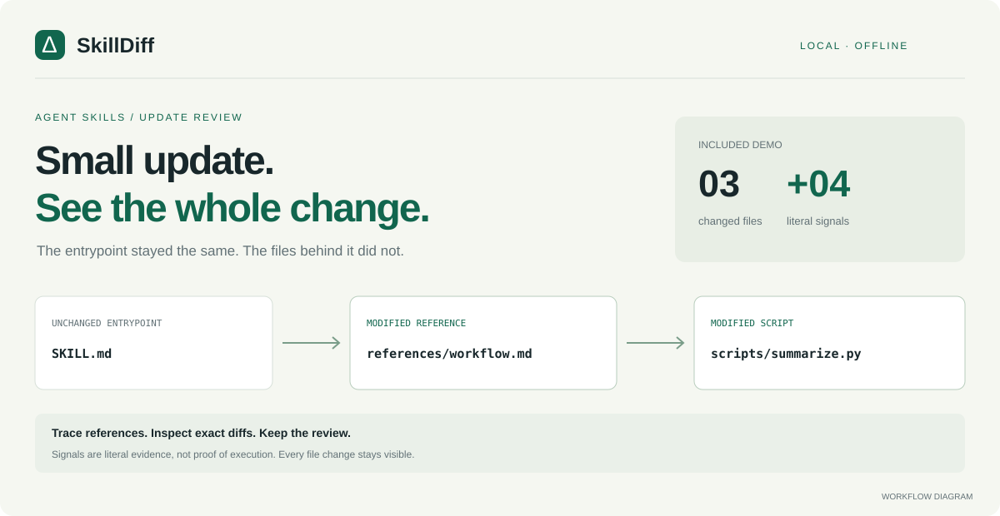

# Δ SkillDiff

### Skill 更新了，究竟还改变了什么？

**沿着 SKILL.md 背后的引用链，审查整个更新。**

[English](README.md) · [工作原理](docs/design.md) · [选题调研](docs/research.zh-CN.md)

入口文件 `SKILL.md` 完全没变，引用文档里的脚本却新增了外部服务和敏感路径。普通阅读容易漏掉这种更新。

SkillDiff 比较一个 Agent Skill 目录的两个版本，记录所有文件的变化，追踪静态引用链，给出新增与删除的文本信号、文件位置和完整文本差异，并生成一份可离线打开的 HTML 报告。

**零运行时依赖，不需要 API Key，不调用模型，没有遥测，不执行 Skill 里的任何代码。**



## 60 秒体验

需要 Python 3.10+。源码下载后无需安装依赖即可运行：

```sh
git clone https://github.com/Sakura2589/skill-diff.git
cd skill-diff
python -m skill_diff diff examples/before examples/after
python -m skill_diff diff examples/before examples/after --format html -o review.html
```

在浏览器中打开 `review.html`。报告是一个独立文件，支持折叠差异、手机布局和打印，没有 JavaScript 或远程资源。

项目也附带了已生成的 [演示报告](docs/demo.html)，下载后可本地打开。

演示中 `SKILL.md` 没变，但报告会找到 **3 个变化文件、4 个新增信号**，包括 `.env`、两个外部域名和一段远程脚本执行示例。所有域名都是 `.invalid`，演示不会联网。

想使用独立命令：在项目根目录运行 `python -m pip install .`，之后可用 `skill-diff` 代替 `python -m skill_diff`。目前未发布 PyPI，名称相近的包不代表本项目。

也可直接下载 [v0.1.0 预发布版](https://github.com/Sakura2589/skill-diff/releases/tag/v0.1.0) 中的 wheel 安装包、源码 ZIP 和 SHA-256 校验文件。安装下载后的 wheel：`python -m pip install skill_diff_review-0.1.0-py3-none-any.whl`。

## 能解决什么问题

| 场景 | 输出 |
|---|---|
| 审查上游 Skill 更新 | 两个本地目录之间的变化和证据 |
| 入口未改，但脚本变了 | `SKILL.md → 参考文件 → 脚本` 路径 |
| 新增域名、敏感路径、执行模式 | 文件名、行号、匹配原文 |
| 普通文字变化，无规则命中 | 仍保留差异，并可阻止 CI 通过 |
| 团队需要固定已审查版本 | 可移植 JSON 快照和漂移检查 |
| 分享审查结果 | 本地 HTML、Markdown、JSON 或终端文本 |

```sh
# 快照必须放在被审查的 Skill 目录外。
skill-diff snapshot ./my-skill -o baseline.json

# 默认任何文件内容变化都返回 1，输入错误或扫描不完整返回 2。
skill-diff check baseline.json ./my-skill

# 即使检查不通过，也先输出报告。
skill-diff check baseline.json ./my-skill --format html -o review.html

# 人工审查后，显式更新基线。
skill-diff snapshot ./my-skill -o baseline.json --force
```

`diff` 默认只输出信息；`check` 默认阻止任何变化。可用 `--fail-on signals` 或 `--fail-on high` 降低门槛，但它们会放过未命中规则的文字变化。完整用法见 [英文文档](README.md) 和 [CI 示例](docs/ci.md)。

## 边界

这是辅助审查工具，不是安全认证。文档里的域名不等于真实网络请求；安全警告里的危险命令也可能匹配。高/中表示审查优先级，不是漏洞结论。

每次只处理一个 Skill 目录。目录下所有普通文件都会计算哈希，包括隐藏文件、二进制和未引用资源；仅排除 `.git`、`__pycache__` 目录。符号链接、无法读取的文件或超限输入会直接报错，不输出“部分通过”。

引用解析支持 Markdown 链接、像文件路径的行内代码和 `@file`；目录外的文件和远程资源不会读取。动态导入、混淆内容、自然语言意图不在识别范围内。`allowed-tools` 保留为文本声明，不完整解析 YAML。

快照和报告包含源文件内容，**可能包含密钥或其他敏感信息**，分享前需要自行检查。程序不自动上传任何内容。哈希检测内容变化，不能证明来源可信或已经获得审批。

## 开源状态

v0.1.0 是可运行的早期版本。已有目录比较、引用图、快照、报告、CI 配方与自动化测试。尚未完成大规模真实用户验证，也不声称优于现有安全扫描器。

相关项目包括 [Vercel Skills](https://github.com/vercel-labs/skills)、[SkillSpector](https://github.com/NVIDIA/skillspector) 和功能相邻的 [SkilLock](https://github.com/skills-lock/skil-lock)。本项目聚焦引用链解释和更新审查体验；代码与演示样例为独立实现。

欢迎提交脱敏后的真实更新案例、引用解析边界和误报样例。详见 [贡献指南](CONTRIBUTING.md) 与 [路线图](docs/roadmap.md)。MIT 许可。
